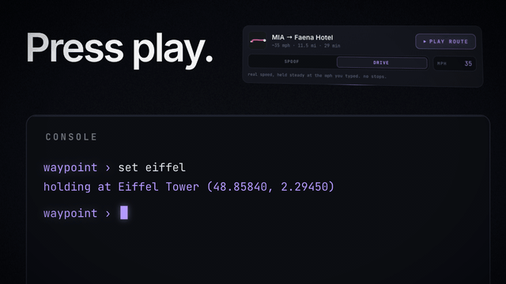
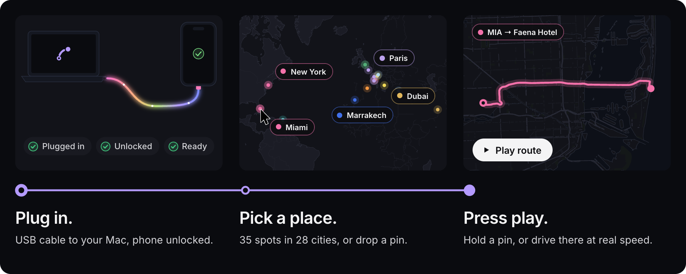
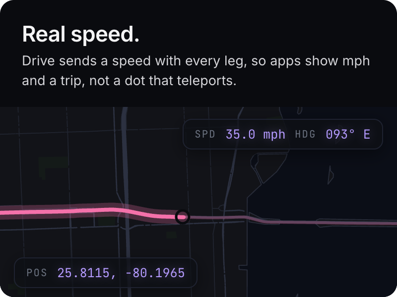
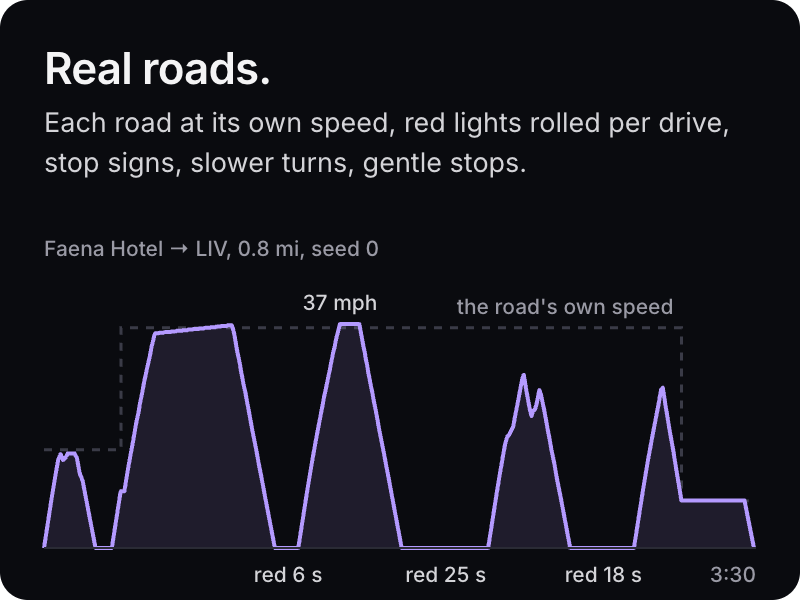
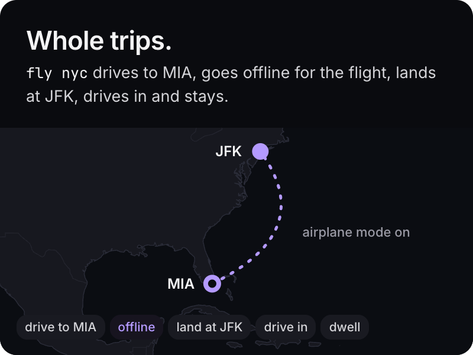
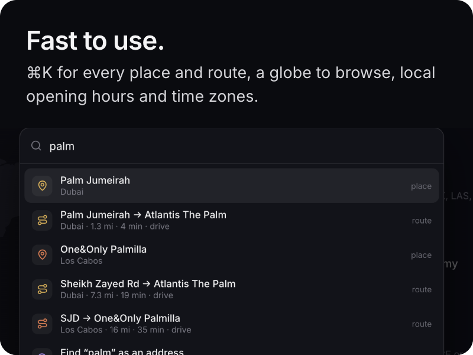
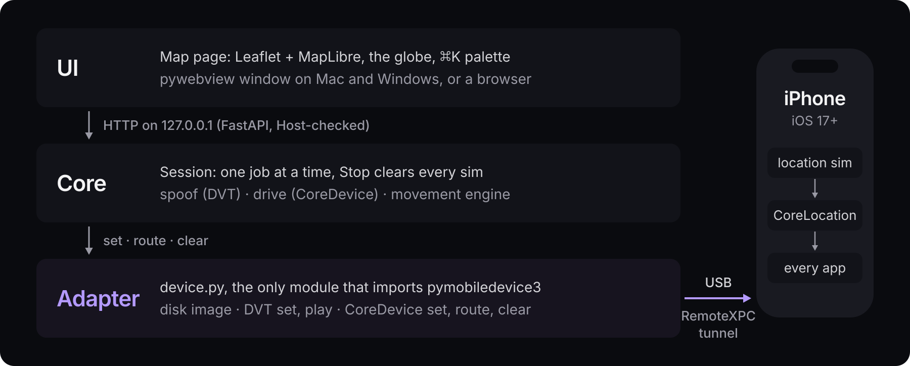
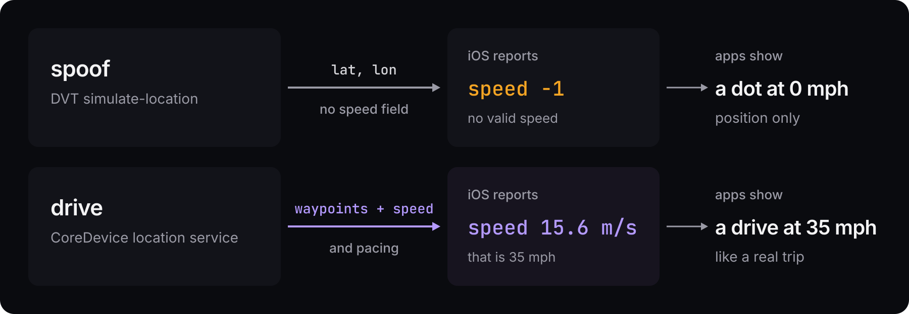
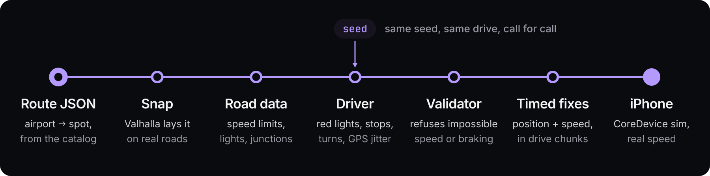

<p align="center">
  
</p>

<p align="center">
  Set your own iPhone's location from your Mac or PC: pins, real-speed drives on real roads, whole trips.<br>
  No jailbreak, no Xcode. One USB cable.
</p>

<p align="center">
  
</p>

<p align="center">
  <picture>
    <source srcset="docs/readme/loop.webp" type="image/webp">
    
  </picture>
</p>

## Three steps

<p align="center">
  
</p>

## What it does

<p align="center">
  
  
  <br>
  
  
</p>

## How it works

iOS ships a developer location-simulation service, the one Xcode uses. It feeds CoreLocation
directly, so every app on the phone sees the simulated position. Waypoint reaches it over Apple's
RemoteXPC tunnel with [pymobiledevice3](https://github.com/doronz88/pymobiledevice3), in three layers.

<p align="center">
  
</p>

Apple changes that transport from time to time (it broke between iOS 16 and 17). Every transport
detail lives in one module, `core/backend/device.py`, so the next break is a one-file fix.

<p align="center">
  
</p>

There are two simulation services on the phone, and the difference between them is the whole
real-speed story. The older DVT service takes a position and nothing else, so iOS reports the speed
as invalid. The CoreDevice service takes waypoints with a speed, so location-sharing apps see mph
and a moving trip. Waypoint's `spoof` engine uses the first, `drive` the second.

<p align="center">
  
</p>

Every drive goes through the same pipeline. The driver model brakes 1.4 to 1.75 m/s² before a
cap and pulls away more gently the faster it goes; the validator refuses any route it can't
believe before a single fix reaches the phone. A route can carry a seed, and the same seed gives
the same drive call for call: lights, stops, turns, jitter and timing.

- **No Xcode, no admin, no jailbreak.** pymobiledevice3's userspace tunnel is pure Python, needs no
  driver, and mounts Apple's developer disk image itself.
- **Local only.** One FastAPI process on 127.0.0.1 that refuses any other Host header (DNS
  rebinding) and any cross-origin write.
- **Signed updates.** The Mac release build checks the download's sha256, an Ed25519 signature
  and the code signature before it swaps a new build in, and only after the app quits.
- **163 tests**, all offline: `.venv/bin/python -m unittest discover -s core/tests`

## In numbers

<p align="center">
  
</p>

Every city in the catalog has its arrival airport and its time zone, and its restaurants and
clubs carry their local opening hours. Coordinates come from OpenStreetMap. The routes (airport,
hotel, spot) are generated from the catalog, and a route that fails validation is never written.

## Quickstart

<table>
<tr><th width="50%" align="left">macOS</th><th width="50%" align="left">Windows</th></tr>
<tr><td valign="top">

```sh
# Python env + pymobiledevice3 (needs uv)
./mac-version/setup.command
# Waypoint.app in ~/Applications
./mac-version/make-app.command
# or try it with no phone at all
VIDA_DRY_RUN=1 ./mac-version/app.command
```

Full guide: [mac-version/README.md](mac-version/README.md)

</td><td valign="top">

```bat
:: needs the Apple Devices app or iTunes, and uv
windows-version\setup.cmd
:: the Waypoint window
windows-version\waypoint.cmd
:: or try it with no phone at all
set VIDA_DRY_RUN=1 & windows-version\waypoint.cmd
```

Full guide: [windows-version/README.md](windows-version/README.md)

</td></tr>
</table>

Then plug the iPhone in, unlock it, tap **Trust**, and turn on Developer Mode (Settings → Privacy
& Security). The first connection downloads Apple's developer disk image, which takes a few
minutes once.

## Limits, honestly

- **Cable only.** The phone stays plugged in by USB while it plays. Closing Waypoint puts it back
  on its real GPS.
- **Unlocked and awake.** A phone that locks can drop the session.
- **Developer Mode,** which an iOS update turns off again.
- **Position, not motion.** Features built on the accelerometer, like driving reports or crash
  detection, can't be faked on a phone that is sitting still.
- **Your own phone.** Each person runs it on their own iPhone, from their own computer.
- **Windows runs from the repo:** no installer or auto-update yet.

<details>
<summary><b>For agents / future me</b></summary>
<br>

- **[AGENTS.md](AGENTS.md)**: how it works, architecture, locked decisions, ground rules. *Read first.*
- **[ROADMAP.md](ROADMAP.md)**: milestones and current focus.
- **[PROGRESS.md](PROGRESS.md)**: running dev log and current state.

| Folder | What's in it |
|---|---|
| **[mac-version/](mac-version/README.md)** | Mac launchers and the Waypoint app, including **real-speed driving**. |
| **[windows-version/](windows-version/README.md)** | Windows launchers and the Waypoint window. Same engine, real speed works there too. |
| [core/](core/README.md) | The shared engine both versions run: route engine, routes, tests. You don't run anything from here directly. |
| [docs/](docs/) | Design docs and research. `docs/readme/` holds this page's art; `docs/readme/build.sh` rebuilds it. |

Fix something in `core/` and both versions get it.

</details>

<p align="center">
  <picture>
    <source media="(prefers-color-scheme: dark)" srcset="docs/readme/divider-dark.svg">
    
  </picture>
</p>

<p align="center"><sub>
Map data © OpenStreetMap contributors (ODbL) · World outlines from Natural Earth · Routes snapped with Valhalla<br>
Inter and JetBrains Mono under the SIL Open Font License · Simulates the location of your own iPhone only
</sub></p>
